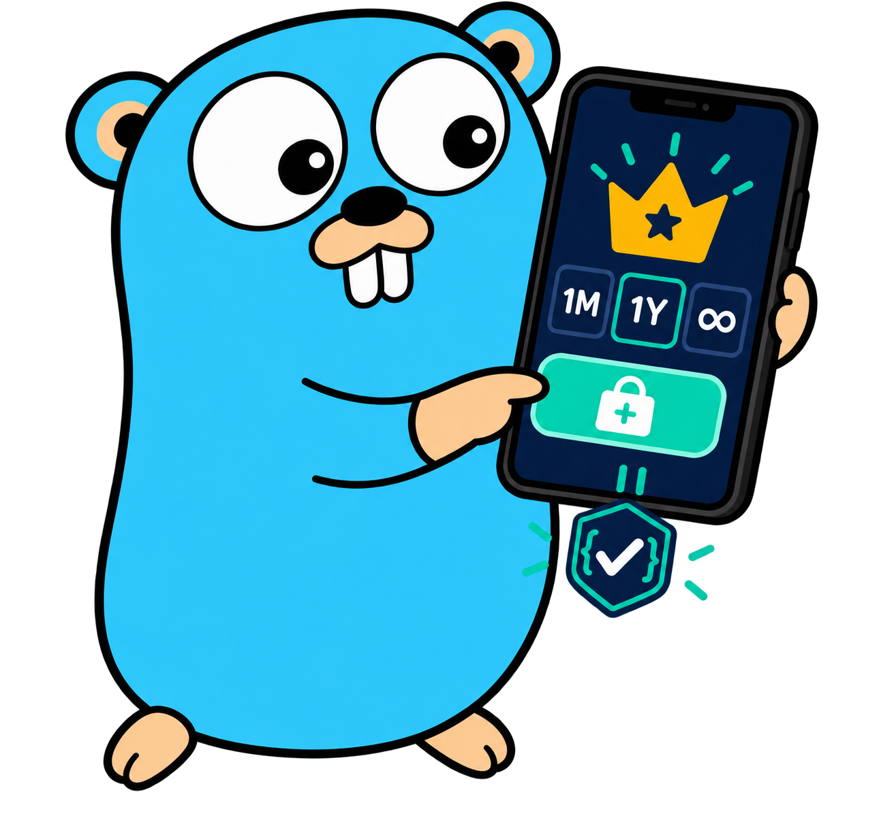

<p align="center">
  
</p>

<h1 align="center">IAPStack</h1>

<p align="center">
  <strong>Verifica degli acquisti in-app ed entitlement, open source e self-hosted.</strong>
  <br>
  Un unico modello gestito dal backend per Apple App Store, Google Play e Huawei AppGallery.
  <br>
  Scritto in Go. Indipendente dagli store. Installabile ovunque.
</p>

<p align="center">
  <a href="https://imariman.github.io/iapstack/it/"><strong>Sito web</strong></a>
  ·
  <a href="#quick-start"><strong>Avvio rapido</strong></a>
  ·
  <a href="#deploy"><strong>Deployment</strong></a>
  ·
  <a href="#documentation"><strong>Documentazione</strong></a>
  ·
  <a href="contracts/openapi/v1.yaml"><strong>OpenAPI</strong></a>
  ·
  <a href="CONTRIBUTING.md"><strong>Contribuire</strong></a>
</p>

<p align="center">
  <a href="README.md">English</a>
  · <a href="README.de.md">Deutsch</a>
  · <a href="README.es.md">Español</a>
  · <a href="README.fr.md">Français</a>
  · <strong>Italiano</strong>
  · <a href="README.pt-BR.md">Português (Brasil)</a>
  · <a href="README.tr.md">Türkçe</a>
  · <a href="README.ru.md">Русский</a>
  · <a href="README.ja.md">日本語</a>
  · <a href="README.ko.md">한국어</a>
  · <a href="README.zh-CN.md">简体中文</a>
</p>

<p align="center">
  <a href="https://github.com/imariman/iapstack/actions/workflows/ci.yml"></a>
  <a href="LICENSE"></a>
  
  
</p>

<p align="center">
  <picture>
    <source media="(prefers-color-scheme: dark)" srcset="assets/dashboard-dark.png">
    
  </picture>
</p>

<p align="center">
  <sub>La dashboard operativa segue il tema del tuo sistema (nel prodotto: Sistema / Chiaro / Scuro). Sono mostrati dati demo sintetici.</sub>
</p>

> [!NOTE]
> Questa è una traduzione del [README in inglese](README.md). In caso di differenze, fa fede la versione inglese. Sviluppo, struttura del repository e istruzioni di deployment passo passo sono mantenuti solo in inglese.

> [!IMPORTANT]
> IAPStack è software in pre-release. Le release esistenti `v0.1.0-rc1` e `v0.1.0-rc2`
> sono anteprime legacy precedenti all'attuale release gate e alle correzioni di
> sicurezza; non sono supportate per l'uso in produzione. Il branch predefinito resta in
> sviluppo e il suo gate sul ciclo di vita con store reali per i tre provider non è ancora completo.

IAPStack è un backend self-hosted con pannello di controllo per convalidare gli acquisti
in-app e trasformare le transazioni degli store in entitlement applicativi durevoli. Offre
ai team un unico modello gestito dal backend per tutti gli store mobili, mantenendo
credenziali, dati di acquisto e decisioni di accesso su un'infrastruttura che controllano.

<p align="center">
  <code>Store&nbsp;&nbsp;→&nbsp;&nbsp;Verify&nbsp;&nbsp;→&nbsp;&nbsp;Access&nbsp;&nbsp;→&nbsp;&nbsp;Deliver</code>
</p>

| Verifica una volta, ovunque | Entitlement, non ricevute | Lo gestisci tu |
| --- | --- | --- |
| Verifica lato server per Apple App Store, Google Play e Huawei AppGallery dietro un unico modello indipendente dagli store. | Le app chiedono a cosa può accedere un cliente invece di interpretare ricevute grezze e stati degli store. | Self-hosted per impostazione predefinita: infrastruttura, credenziali, dati di acquisto e decisioni di accesso sono tuoi. |

<a id="current-scope"></a>

## Ambito attuale

- Verifica lato server di abbonamenti e acquisti a vita non consumabili
  da Apple App Store, Google Play e Huawei AppGallery
- Un modello di transazioni ed entitlement indipendente dagli store, basato su PostgreSQL
- Acquisizione durevole delle notifiche, riconciliazione del ciclo di vita e webhook in uscita firmati
- Una dashboard operativa autenticata (temi Sistema / Chiaro / Scuro, una barra laterale
  dei progetti comprimibile e grafici di attività e abbonamenti consultabili) con
  contratti HTTP/OpenAPI versionati
- Pacchetti Flutter neutrali rispetto al provider e specifici per store per tutti e tre i provider attuali
- Deployment compatto o con API/worker separati, con Docker e target cloud documentati

L'evasione degli acquisti consumabili, la migrazione dei clienti e il consolidamento degli
alias, l'operatività in hosting e gli store oltre i tre indicati sono fuori dall'ambito della
v0.1. Consulta l'[ambito della v0.1](docs/v0.1-scope.md) per il perimetro completo.

<a id="sdk-roadmap"></a>

## Roadmap degli SDK

Flutter resta l'unico client mobile nell'ambito della release v0.1: un client HTTP
neutrale rispetto al provider più i companion per Apple, Google Play e Huawei. Altro
codice SDK è già presente nel repository, secondo il piano di espansione in
[#85](https://github.com/imariman/iapstack/issues/85). La sua presenza non estende il
release gate della v0.1 né rende questi pacchetti release di produzione.

| SDK | Implementato nel repository | Lavoro rimanente |
| --- | --- | --- |
| [Go per host attendibile](sdk/go/README.md) | Sessioni cliente, consultazione degli entitlement lato server e gestione dei webhook firmati | Prima pubblicazione di un modulo versionato ([#141](https://github.com/imariman/iapstack/issues/141)) |
| [TypeScript per host attendibile](sdk/typescript/README.md) | Sessioni cliente, consultazione degli entitlement, webhook firmati e archivi ESM/tipi installabili | Prima pubblicazione su npm ([#141](https://github.com/imariman/iapstack/issues/141)) |
| [iOS (Swift)](sdk/ios/README.md) | Client HTTP, companion StoreKit 2, esempio eseguibile con configurazione StoreKit, manifest SwiftPM nella root | Primo tag di versione dell'SDK ([#141](https://github.com/imariman/iapstack/issues/141)) |
| [Android (Kotlin)](sdk/android/README.md) | Client HTTP, adapter Play Billing/HMS, esempio per host attendibile e binari Maven/jar dei sorgenti preparati | Prima pubblicazione su GitHub Maven ([#141](https://github.com/imariman/iapstack/issues/141)) |
| [React Native](sdk/react-native/README.md) | Client HTTP, bridge nativo StoreKit/Play/Huawei, app di esempio nativa e sorgenti dei companion impacchettati | Prima pubblicazione su npm ([#141](https://github.com/imariman/iapstack/issues/141)) |

La [guida alle release degli SDK](docs/sdk-releases.md) documenta installazione, versioni
pre-release indipendenti, controlli dei pacchetti e configurazione dei registry. Il codice
in questo repository non implica l'esistenza di una release su un registry.

Il bearer durevole dell'applicazione resta su un backend host attendibile e non deve mai
essere incluso in un binario mobile o in un bundle per browser. I client mobili usano
sessioni cliente di breve durata.

<a id="quick-start"></a>

## Avvio rapido

Ti servono Docker con Compose e OpenSSL. Da un clone di questo repository, genera
segreti solo locali e avvia lo stack completo:

```sh
export IAPSTACK_POSTGRES_PASSWORD="$(openssl rand -base64 32)"
export IAPSTACK_PROTECTION_ACTIVE_KEY_ID="local-1"
export IAPSTACK_PROTECTION_KEYS="{\"local-1\":\"$(openssl rand -base64 32)\"}"
export IAPSTACK_PROTECTION_FINGERPRINT_KEY="$(openssl rand -base64 32)"
export IAPSTACK_BOOTSTRAP_ADMIN_KEY="$(openssl rand -base64 48)"
export IAPSTACK_METRICS_BEARER_TOKEN="$(openssl rand -base64 48)"
docker compose -f deploy/compose.yaml up --build -d --wait
curl --fail http://127.0.0.1:8080/readyz
```

Conserva i valori generati in modo sicuro e riutilizzali con questo volume Compose.
Rigenerarli non ruota la password del database né le chiavi di protezione esistenti.

Poi apri `http://127.0.0.1:8080/dashboard/` e connettiti con la chiave di bootstrap
dell'amministratore. Crea e conserva una chiave di amministratore durevole, rimuovi
`IAPSTACK_BOOTSTRAP_ADMIN_KEY` dall'ambiente e ricrea il container dell'API.
La [guida operativa](docs/operations.md) spiega bootstrap, rotazione delle chiavi,
arresto, backup, aggiornamenti e la baseline di sicurezza per la produzione.

<a id="deploy"></a>

## Deployment

Confronta requisiti dell'account, limiti dei piani gratuiti e costi dello stack completo
nella [matrice dei target di deployment](deploy/README.md) prima di creare risorse presso
un provider.

[](https://render.com/deploy?repo=https://github.com/imariman/iapstack)
[](https://www.heroku.com/deploy?template=https://github.com/imariman/iapstack)
[](https://cloud.oracle.com/resourcemanager/stacks/create?zipUrl=https://imariman.github.io/iapstack/deploy/iapstack-oracle-stack.zip)

| Target | Configurazione | Guida |
| --- | --- | --- |
| Render | Un web service gratuito che esegue API e worker, un database PostgreSQL gratuito per i test e Blueprint a pagamento compatti o separati | [Guida Render](deploy/render/README.md) |
| Heroku | API, worker e PostgreSQL gestito su due dyno Basic sempre attivi; nessun runtime gratuito | [Guida Heroku](deploy/heroku/README.md) |
| DigitalOcean | App Platform con un worker e un job di migrazione, oppure un Droplet più economico | [Guida App Platform](deploy/digitalocean/README.md) · [Guida Droplet](deploy/digitalocean/droplet.md) |
| Fly.io | Process group con Managed Postgres privato; solo una breve prova gratuita | [Guida Fly.io](deploy/fly/README.md) |
| Koyeb | Database gestito, API HTTPS e worker privato tramite la CLI ufficiale | [Guida Koyeb](deploy/koyeb/README.md) |
| Railway | PostgreSQL e un servizio che esegue API e worker; circa USD 5 al mese con il piano Hobby | [Guida Railway](deploy/railway/README.md) |
| Coolify | Lo stack completo da una definizione Docker Compose inclusa nel repository, sul tuo server | [Guida Coolify](deploy/coolify/README.md) |
| VM singola | L'opzione continua più economica: PostgreSQL, migrazioni, API e worker su una macchina Linux dietro un Cloudflare Tunnel | [Guida VM singola](deploy/vps/README.md) |

### Opzione più economica: una VM singola

Una macchina Linux esegue tutto a partire da
[`deploy/vps/compose.yaml`](deploy/vps/compose.yaml): PostgreSQL su una rete Docker
privata, un container di migrazione one-shot, un unico processo compatto con l'API e il
worker durevole, e un connettore Cloudflare Tunnel, quindi la VM non ha bisogno di porte
in ingresso aperte. Il worker richiede un processo sempre in esecuzione, ed è per questo
che una piccola VM sempre attiva è più adatta delle piattaforme scale-to-zero.

| Host | Costo tipico | Adatto per |
| --- | --- | --- |
| Oracle Cloud Always Free, Ampere A1 | USD 0 | Fino a 4 OCPU Arm e 24 GB di RAM; stack Resource Manager con un clic. |
| Google Cloud e2-micro (Free Tier, regioni USA) | USD 0–4/mese | 1 GB di RAM per traffico ridotto; procedura guidata in Cloud Shell. |
| Hetzner Cloud CAX11 / CX22 | Circa EUR 4–5/mese | Fatturazione prevedibile; installazione da un unico file cloud-init. |
| DigitalOcean Droplet `s-1vcpu-1gb` / `s-1vcpu-2gb` | USD 6 / 12 al mese | IPv4 pubblico incluso; stesso file cloud-init di Hetzner. |
| Un server che gestisci già | USD 0 | Funziona dietro NAT, ma le notifiche degli store richiedono un uptime continuo. |

Ti serve anche un dominio con DNS sul piano gratuito di Cloudflare. Verifica le condizioni
aggiornate di ogni provider prima di creare risorse. I passaggi di installazione, i backup
e gli aggiornamenti sono descritti nella [sezione Deploy del README in inglese](README.md#deploy)
e nella [guida alla VM singola](deploy/vps/README.md).

<a id="design-principles"></a>

## Principi di progettazione

**Self-hosted per impostazione predefinita.** Infrastruttura, credenziali, dati di acquisto e decisioni di accesso sono tuoi.

**Gli store sono adapter.** Le API specifiche di ogni store restano isolate dietro contratti condivisi; il dominio centrale non dipende da un singolo marketplace.

**Gli entitlement sono il confine del prodotto.** Le applicazioni chiedono a cosa può accedere un cliente invece di interpretare ricevute grezze o stati degli store.

**Deployment ovunque.** L'obiettivo è un semplice deployment basato su container, senza dipendere da una specifica piattaforma cloud.

**Implementazione indipendente.** La documentazione ufficiale degli store definisce comportamento e requisiti di sicurezza. Altri progetti open source possono essere studiati per l'interoperabilità e i casi limite, mentre il codice di IAPStack è implementato in modo indipendente.

<a id="documentation"></a>

## Documentazione

La documentazione è scritta in inglese.

- [Ambito e architettura della v0.1](docs/v0.1-scope.md)
- [Architecture Decision Records](docs/adr/README.md)
- [API HTTP v1 e contratti delle notifiche dei provider](docs/api-v1.md)
- [Contratto OpenAPI v1 leggibile dalle macchine](contracts/openapi/v1.yaml)
- [Guida operativa e alla dashboard](docs/operations.md)
- [Threat model della v0.1 e checklist di sicurezza per le release](docs/security.md)
- [Policy di sicurezza e segnalazione delle vulnerabilità](SECURITY.md)
- [Guida per contribuire](CONTRIBUTING.md)
- [Guida al supporto](SUPPORT.md)
- [SDK Flutter neutrale rispetto al provider](sdk/flutter/iapstack/README.md)
- [SDK Swift nativo per iOS e companion StoreKit](sdk/ios/README.md)
- [SDK Go per host attendibile](sdk/go/README.md)
- [SDK TypeScript per host attendibile](sdk/typescript/README.md)

<a id="development"></a>

## Sviluppo

Build dai sorgenti, configurazione, test e struttura del repository sono descritti nella
[sezione Development del README in inglese](README.md#development). Leggi la
[guida per contribuire](CONTRIBUTING.md) prima di aprire una pull request.

<a id="roadmap"></a>

## Roadmap

- [x] Definire il dominio centrale, i contratti delle API pubbliche e il modello di persistenza
- [x] Implementare i primi adapter per Apple App Store, Google Play e Huawei AppGallery
- [x] Aggiungere le migrazioni PostgreSQL e una configurazione Docker pensata per la produzione
- [x] Realizzare l'SDK Flutter neutrale rispetto al provider, i tre SDK Flutter specifici per provider e la dashboard
- [x] Supportare la riconciliazione del ciclo di vita e i webhook in uscita firmati
- [x] Pubblicare un contratto API v1 leggibile dalle macchine con controlli di compatibilità dei client
- [x] Implementare gli SDK Go, TypeScript, Swift, Kotlin e React Native
- [x] Supportare la migrazione dei clienti, il consolidamento degli alias, le importazioni da RevenueCat e le importazioni dei report finanziari
- [x] Aggiungere i manifest di deployment per Kubernetes
- [ ] Completare i release gate del ciclo di vita per Apple App Store, Google Play e Huawei e pubblicare `v0.1.0-rc.1`
- [ ] Risolvere il feedback sulla release candidate e pubblicare la versione stabile `v0.1.0`
- [ ] Pubblicare pacchetti versionati per host, Android, iOS e React Native ([#141](https://github.com/imariman/iapstack/issues/141))
- [ ] Aggiungere Amazon Appstore e altri adapter per store

Gli elementi completati descrivono implementazioni presenti nel repository, non la prontezza per una release di produzione.

<a id="license"></a>

## Licenza

Distribuito con licenza [Apache License 2.0](LICENSE).

Partecipando a questo progetto accetti di rispettare il
[Codice di condotta](CODE_OF_CONDUCT.md). Per contribuire e ricevere supporto, consulta
[CONTRIBUTING.md](CONTRIBUTING.md) e [SUPPORT.md](SUPPORT.md).
